# Testes Caixa Cinza em API de Autenticação — Supabase + Postman

**Aluno:** Thiago Silva Feitosa
**Disciplina:** UX/UI
**Professor:** Daniel Ohata
**Data:** 07/11/2026

---

## Sumário

1. [Introdução](#introdução)
2. [Objetivo da Atividade](#objetivo-da-atividade)
3. [Configuração do Supabase](#configuração-do-supabase)
4. [Configuração do Postman](#configuração-do-postman)
5. [Configuração das Requisições](#configuração-das-requisições)
6. [Execução dos Testes](#execução-dos-testes)
7. [Registro dos Testes](#registro-dos-testes)
8. [Resultados Obtidos](#resultados-obtidos)
9. [Conclusão](#conclusão)

### Estrutura do repositório

```
/README.md        → documentação completa da atividade
/postman/         → collection e environment exportados do Postman
/prints/          → evidências (capturas de tela)
/planilha/        → planilha de registro dos testes
```

---

# Introdução

A autenticação é uma das partes mais críticas de qualquer sistema: é ela que garante que apenas usuários legítimos acessem recursos protegidos. Por isso, a API responsável pelo login precisa ser testada não só no "caminho feliz" (credenciais corretas), mas também em situações de erro, como senha errada, usuário inexistente ou dados mal formatados.

Neste trabalho foi configurado um serviço de autenticação real utilizando o **Supabase** (plataforma Backend-as-a-Service baseada em PostgreSQL, cujo módulo de autenticação é o GoTrue) e foram executados testes funcionais com o **Postman Desktop** sobre o endpoint de login por e-mail e senha.

Os testes seguem a abordagem **caixa cinza**: não há acesso ao código-fonte do servidor de autenticação (como na caixa branca), mas há conhecimento parcial da estrutura — o endpoint, o método HTTP, os headers exigidos, o formato do corpo JSON e os códigos de resposta esperados. Esse conhecimento permite projetar casos de teste mais direcionados do que em um teste puramente caixa preta.

# Objetivo da Atividade

Compreender e aplicar testes de caixa cinza em uma API de autenticação, por meio de:

- configuração de um ambiente de autenticação no Supabase;
- criação de um usuário para testes;
- entendimento da estrutura de uma requisição HTTP (método, URL, headers e body);
- uso do Postman para montar e executar as requisições, com variáveis de ambiente e scripts de validação automática;
- validação das respostas da API (status HTTP, JSON, mensagens de erro e access token);
- documentação técnica de todo o processo neste README e em uma planilha de testes.

# Configuração do Supabase

### Criação do projeto

1. Acessei [supabase.com](https://supabase.com) e criei uma conta.
2. No dashboard, cliquei em **New project**, selecionei a organização, defini o nome do projeto como `auth-testes-thiago`, uma senha para o banco de dados e a região mais próxima (South America — São Paulo).
3. Aguardei o provisionamento do projeto (cerca de 1–2 minutos).

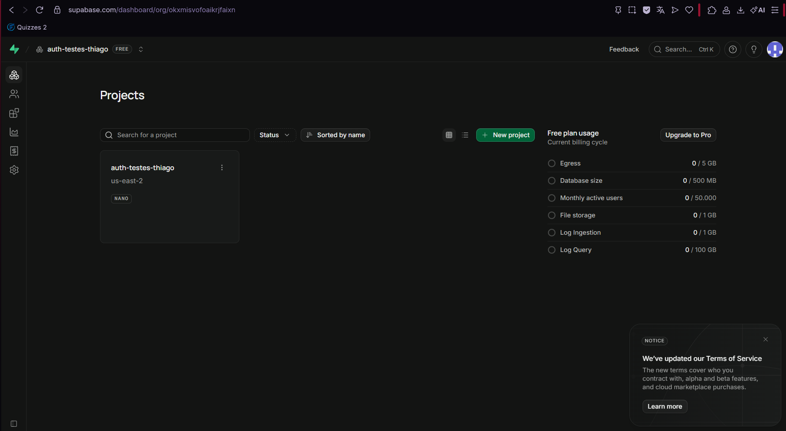
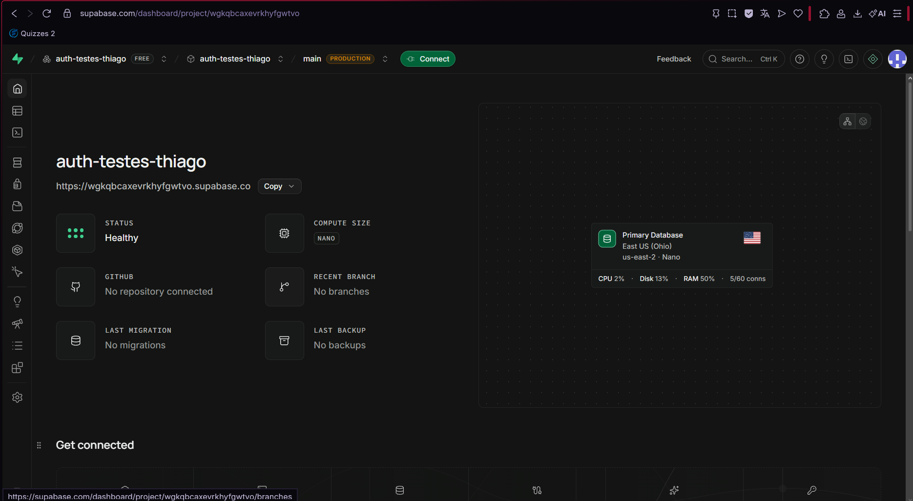

### Tipo de autenticação

Foi utilizada a autenticação por **e-mail e senha** (provider *Email*), que já vem habilitada por padrão. A configuração foi conferida em **Authentication → Sign In / Providers → Email**.

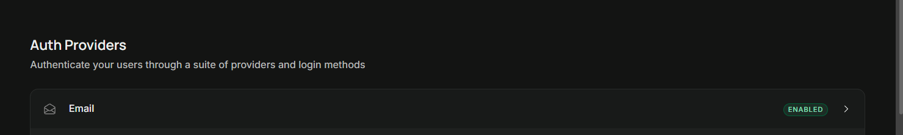

### Criação do usuário de teste

Em **Authentication → Users → Add user → Create new user**, informei:

- E-mail: `thiago.teste@email.com`
- Senha: (definida por mim, registrada apenas no Environment do Postman)
- Opção **Auto Confirm User** marcada, para que o usuário já ficasse confirmado e pudesse fazer login sem precisar validar o e-mail.

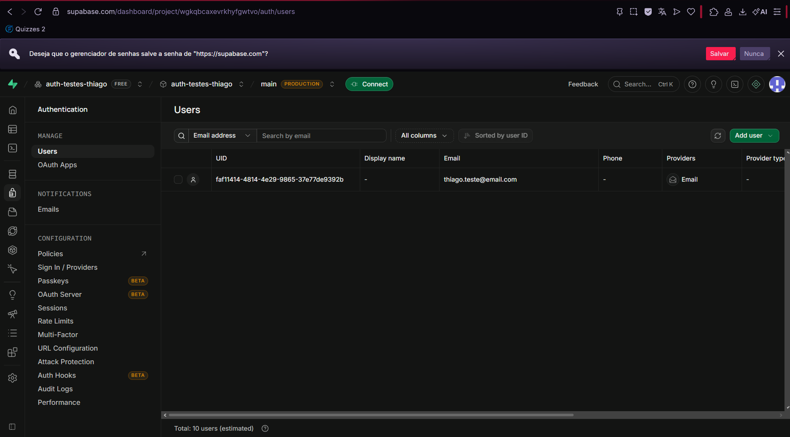

### Credenciais da API

Em **Project Settings → API Keys** (e **Data API** para a URL) foram obtidos:

| Informação | Valor | Uso |
|---|---|---|
| API URL | `https://wgkqbcaxevrkhyfgwtvo.supabase.co` | Endereço base de todas as requisições (`base_url`) |
| API KEY (anon / public) | `eyJ...` (ocultada parcialmente) | Identifica o projeto nas requisições (`api_key`) |

> A chave utilizada é a **anon key** (pública), própria para uso em clientes. A **service_role key** não foi usada nem exposta, pois ela ignora as regras de segurança e dá acesso total ao projeto.

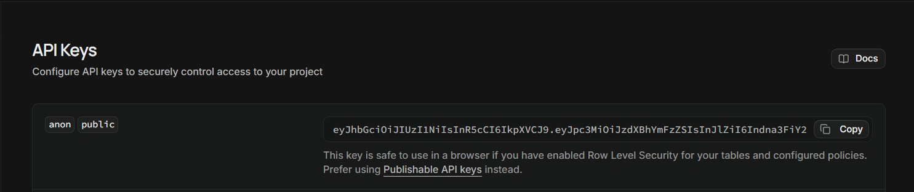
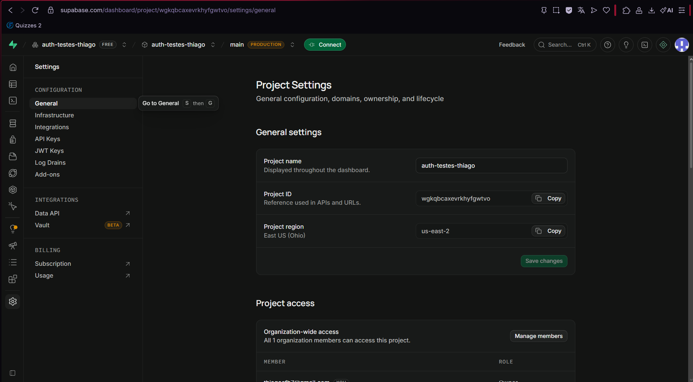

### Objetivo da configuração

O objetivo foi disponibilizar um servidor de autenticação real e funcional, com um usuário conhecido, para que fosse possível enviar requisições de login e observar como a API se comporta tanto com credenciais válidas quanto inválidas.

# Configuração do Postman

### Workspace

No Postman Desktop, em **Workspaces → Create Workspace**, criei o workspace *Testes Auth Supabase*, do tipo *Blank workspace*, para manter todos os artefatos da atividade separados de outros projetos.

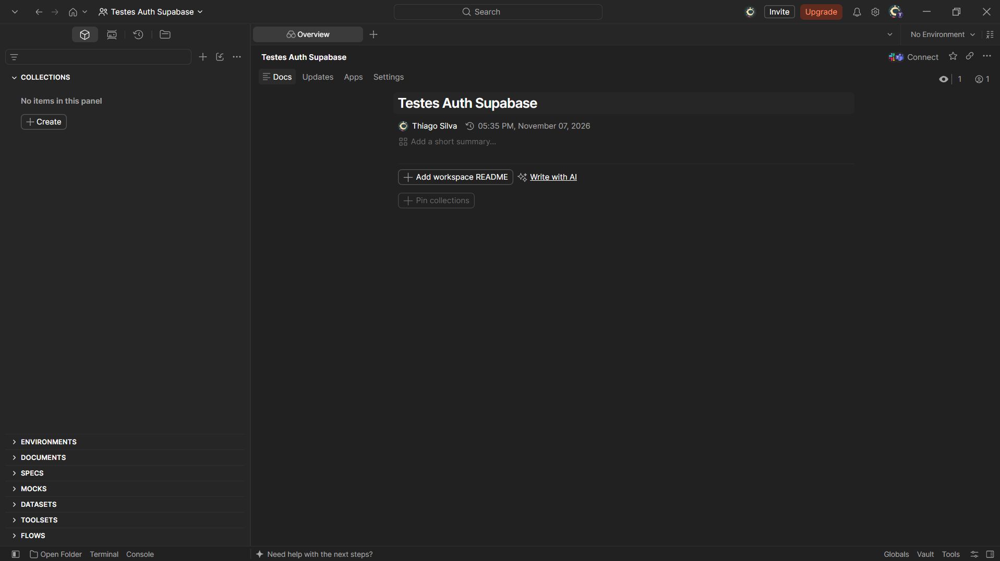

### Environment

Em **Environments → Create Environment**, criei o ambiente **Supabase Auth - Ambiente de Testes** com as variáveis abaixo e o selecionei como ambiente ativo (canto superior direito).

| Variável | Descrição | Exemplo |
|---|---|---|
| `base_url` | URL da API do Supabase | `https://wgkqbcaxevrkhyfgwtvo.supabase.co` |
| `api_key` | API KEY (anon key) do projeto | `eyJhbGciOi...` |
| `email` | E-mail do usuário criado | `thiago.teste@email.com` |
| `password` | Senha do usuário criado | `********` |
| `access_token` | Preenchida automaticamente pelo CT01 | — |

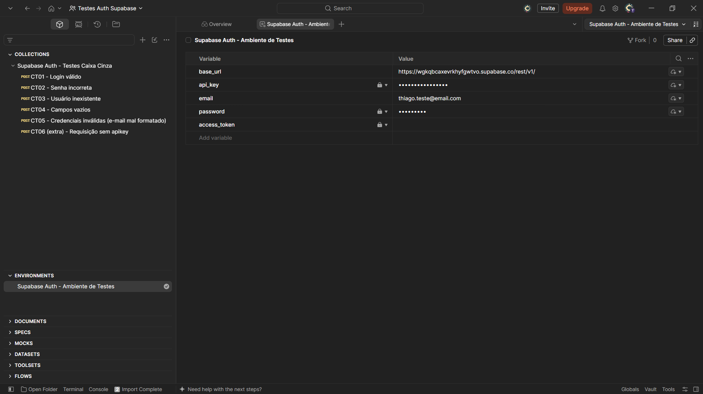
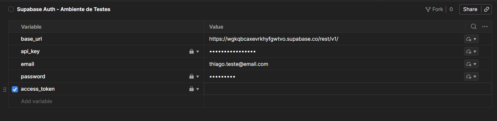

### Finalidade das variáveis

As variáveis evitam repetir URL, chave e credenciais em cada requisição. Assim, se algum dado mudar (por exemplo, a chave da API), basta alterar em um único lugar. Também evitam que dados sensíveis fiquem escritos diretamente nas requisições. Inicialmente `api_key` e `password` foram configuradas como tipo *secret*, mas nessa versão do Postman variáveis secretas ficam bloqueadas no *Vault* e não eram enviadas; por isso foram alteradas para o tipo *default*. Nas requisições, as variáveis são referenciadas com chaves duplas, por exemplo `{{base_url}}`.

### Como o Postman foi utilizado

Foi criada a collection **Supabase Auth - Testes Caixa Cinza**, com uma requisição para cada cenário (CT01 a CT06). Cada requisição possui, na aba **Scripts → Post-response**, testes automatizados em JavaScript (`pm.test`) que validam o status HTTP, a presença ou ausência do `access_token` e a mensagem de erro. A collection também foi executada de uma só vez pelo **Collection Runner**.

Os arquivos exportados estão na pasta [`/postman`](postman/):

- `supabase-auth-tests.postman_collection.json` — collection com as requisições e scripts de teste;
- `supabase-auth.postman_environment.json` — modelo do environment (sem as credenciais reais).

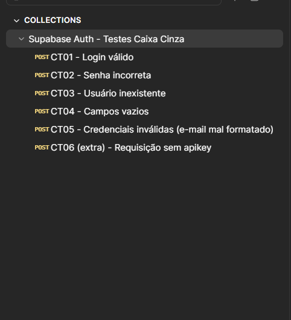

# Configuração das Requisições

### Endpoint e método

| Item | Valor |
|---|---|
| Método HTTP | `POST` |
| URL | `{{base_url}}/auth/v1/token?grant_type=password` |
| Parâmetro de query | `grant_type=password` → indica login por e-mail e senha |

O método **POST** é usado porque a requisição envia dados sensíveis (credenciais) no corpo, e não na URL, e porque gera um novo recurso no servidor (uma sessão/token).

### Headers

| Header | Valor | Finalidade |
|---|---|---|
| `apikey` | `{{api_key}}` | Identifica o projeto Supabase; sem ele a API recusa a requisição |
| `Authorization` | `Bearer {{api_key}}` | Envia a chave no padrão Bearer exigido pelo gateway |
| `Content-Type` | `application/json` | Informa que o corpo está em JSON |

Exemplo de Header:

| Header | Valor |
|---|---|
| apikey | XXXXX |
| Content-Type | application/json |

### Body JSON

Na aba **Body → raw → JSON**:

```json
{
  "email": "{{email}}",
  "password": "{{password}}"
}
```

Exemplo do Body JSON:

```json
{
  "email": "usuario@email.com",
  "password": "123456"
}
```

### Finalidade da requisição

Autenticar um usuário por e-mail e senha. Em caso de sucesso, a API devolve um **access token** (JWT), um refresh token, o tempo de expiração e os dados do usuário. Esse token é o que um aplicativo usaria para acessar recursos protegidos em nome do usuário.

Exemplo de resposta de sucesso (formato):

```json
{
  "access_token": "eyJhbGciOi...",
  "token_type": "bearer",
  "expires_in": 3600,
  "expires_at": 1700000000,
  "refresh_token": "xxxxxxxx",
  "user": { "id": "...", "email": "usuario@email.com", "...": "..." }
}
```

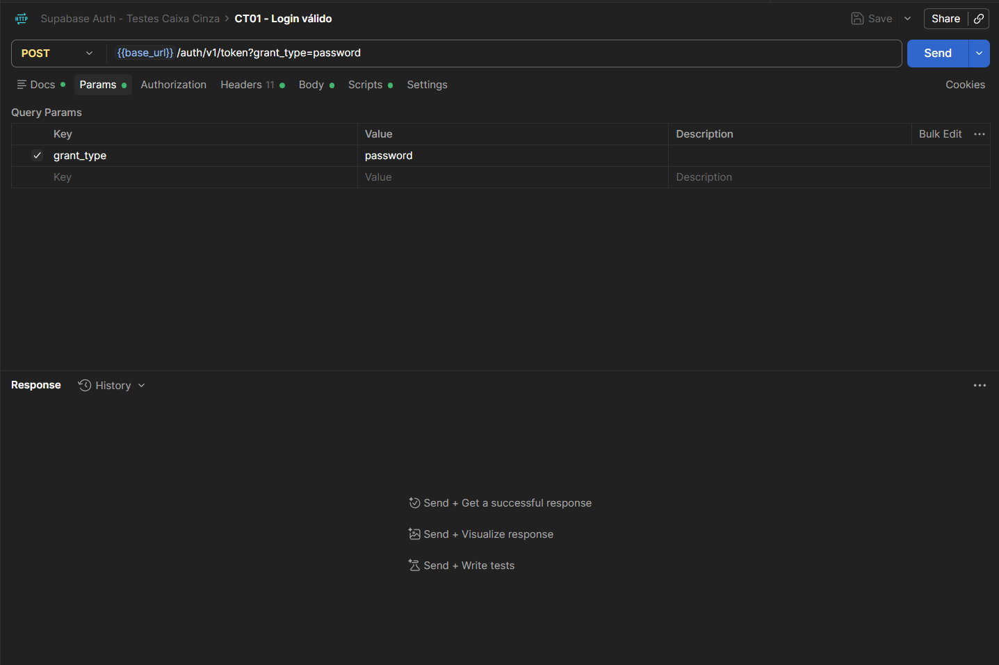
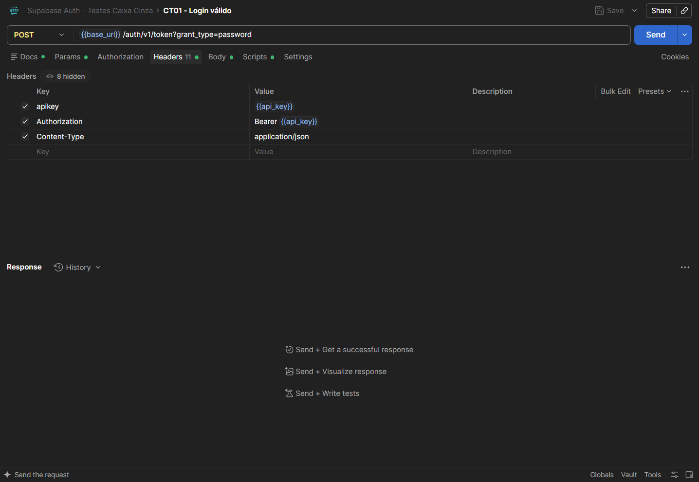
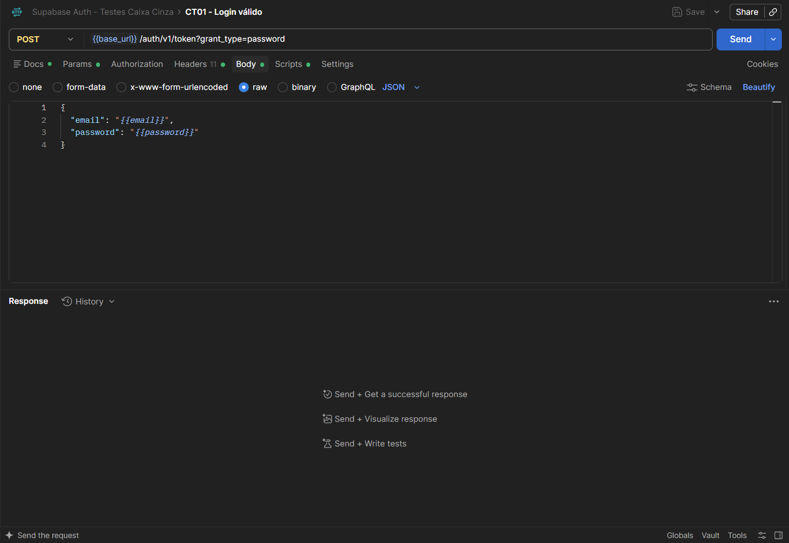

# Execução dos Testes

### Cenários executados

| ID | Cenário | Entrada utilizada | Resultado esperado |
|---|---|---|---|
| CT01 | Login válido | `email` e `password` do usuário criado | Status 200 + `access_token` |
| CT02 | Senha incorreta | `email` correto + senha `senhaErrada123` | Erro de autenticação |
| CT03 | Usuário inexistente | `naoexiste.teste@email.com` / `Qualquer123` | Acesso negado |
| CT04 | Campos vazios | `email: ""`, `password: ""` | Erro de validação |
| CT05 | Credenciais inválidas | `emailinvalido` / `123` | Mensagem de erro |
| CT06 (extra) | Sem header `apikey` | Credenciais corretas, sem `apikey` | Status 401 |

### O que foi validado em cada teste

- **Status HTTP** — código retornado (200, 400, 401...);
- **Resposta JSON** — estrutura do corpo retornado;
- **Mensagens de erro** — campos `msg` / `error_code`;
- **Access token** — presente apenas no login válido;
- **Comportamento da autenticação** — se a API nega o acesso corretamente e não vaza informações.

### Tabela de Cenários

| Cenário | Entrada Utilizada | Resultado Esperado | Resultado Obtido | Status |
|---|---|---|---|---|
| Login válido | Usuário correto (`thiago.teste@email.com` + senha cadastrada) | Status 200 + access token | Status 200 OK, `access_token` JWT, `refresh_token` e dados do usuário retornados | OK |
| Senha incorreta | E-mail correto + senha `senhaErrada123` | Erro de autenticação | Status 400, `"Invalid login credentials"`, sem token | OK |
| Usuário inexistente | `naoexiste.teste@email.com` / `Qualquer123` | Acesso negado | Status 400, `"Invalid login credentials"`, sem token | OK |
| Campos vazios | `email: ""` / `password: ""` | Erro de validação | Status 400 com mensagem de erro, sem token | OK |
| Credenciais inválidas | `emailinvalido` / `123` | Mensagem de erro | Status 400 com mensagem de erro, sem token | OK |
| Sem apikey (extra) | Credenciais corretas, sem header `apikey` | Status 401 | Status 401 Unauthorized, sem token | OK |

### Evidências

**CT01 — Login válido (status 200 + access token)**
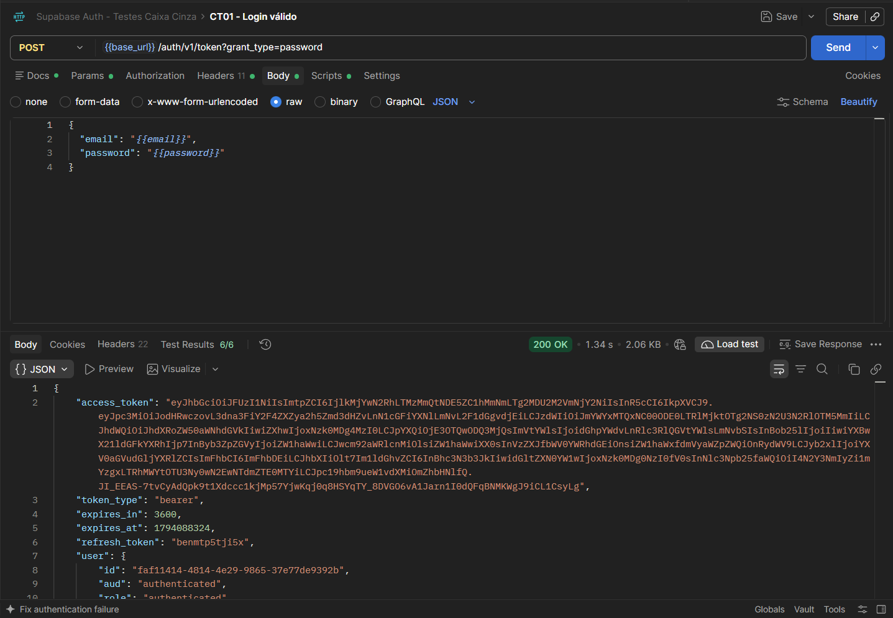

**CT02 — Senha incorreta**
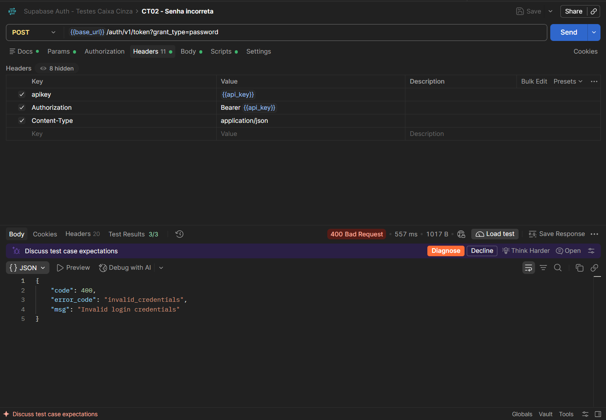

**CT03 — Usuário inexistente**


**CT04 — Campos vazios**
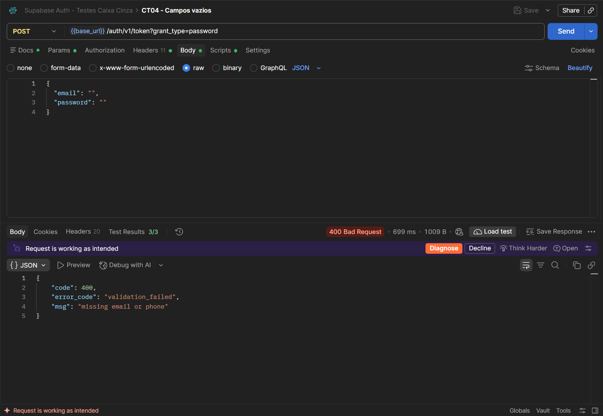

**CT05 — Credenciais inválidas**
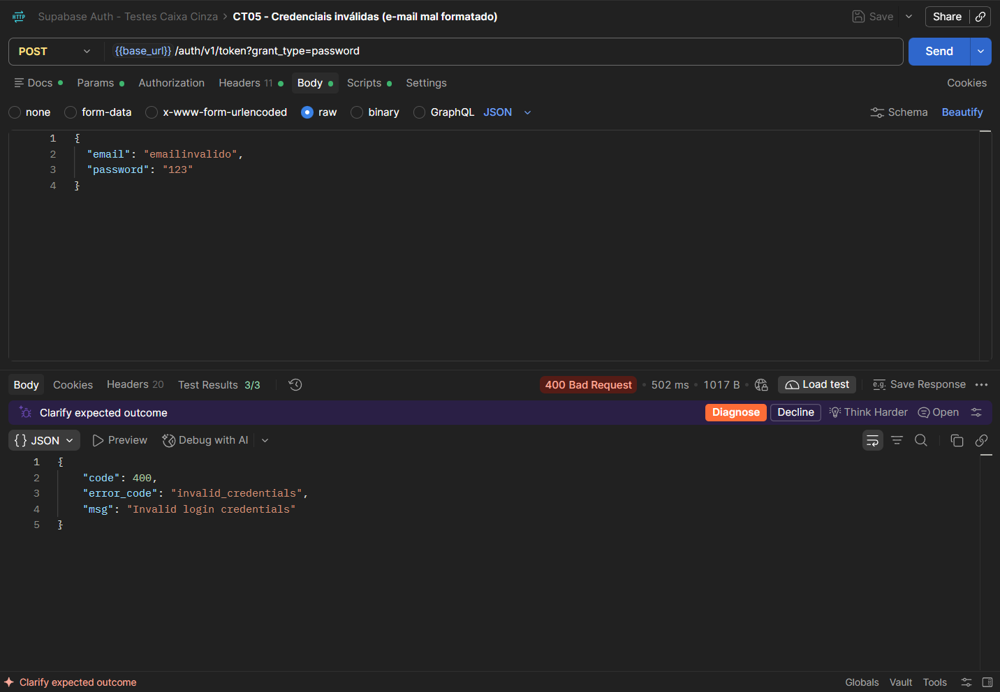

**CT06 — Sem apikey (extra)**
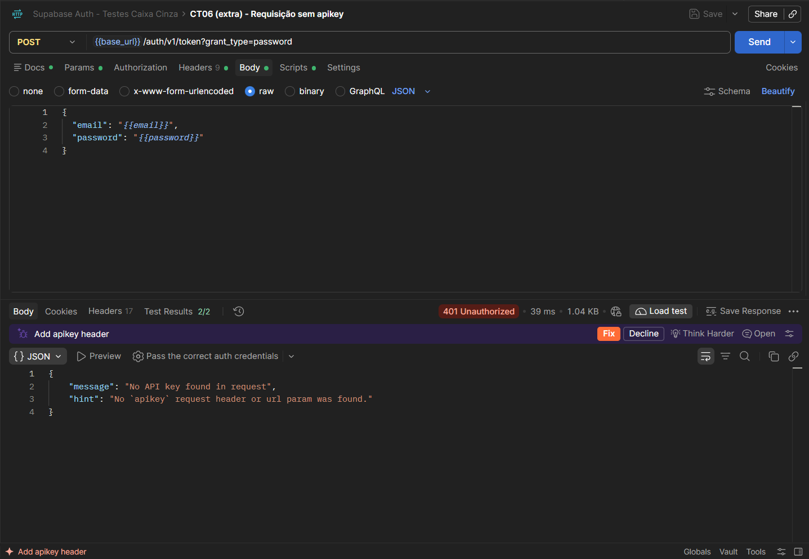

**Resultado dos testes automatizados (Test Results / Collection Runner)**
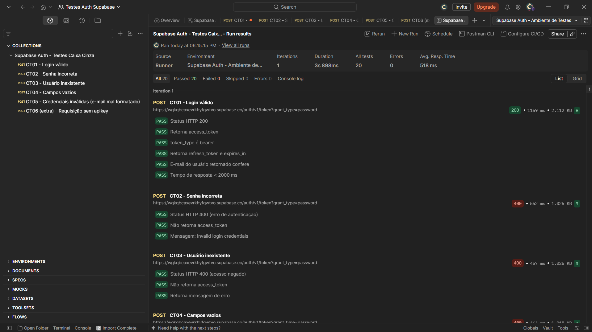

### Erros encontrados

Nenhum cenário apresentou resultado diferente do esperado. Durante a configuração, porém, surgiram erros que foram corrigidos antes da execução final:

- **`401 Unauthorized` — "Invalid API key"** no primeiro login: a variável `api_key` estava com a senha do banco de dados em vez da *anon key*. Corrigido copiando a chave **anon (public)** em *Project Settings → API Keys → Legacy API Keys*.
- **URL base incorreta:** a `base_url` foi copiada com `/rest/v1/` no final (endereço da API do banco). O endpoint de login fica em `/auth/v1/`, então a URL base precisou ficar apenas `https://wgkqbcaxevrkhyfgwtvo.supabase.co`.
- **Variáveis bloqueadas no Vault:** variáveis do tipo *secret* não eram enviadas porque o Vault do Postman estava bloqueado. Corrigido alterando o tipo para *default*.

Observação de comportamento: nos cenários **senha incorreta** e **usuário inexistente** a API retornou exatamente a mesma resposta (`400` — `"Invalid login credentials"`). Isso é intencional e é uma boa prática de segurança: impede que alguém descubra quais e-mails estão cadastrados (enumeração de usuários).

# Registro dos Testes

### Como os testes foram registrados

Todos os cenários foram registrados na planilha [`/planilha/planilha-testes.xlsx`](planilha/planilha-testes.xlsx), com os campos:

| Campo | Descrição |
|---|---|
| ID do teste | Identificação (CT01, CT02...) |
| Cenário | Descrição do caso de teste |
| Entrada | Dados utilizados (e-mail, senha, headers) |
| Resultado esperado | Comportamento correto previsto |
| Resultado obtido | O que a API realmente retornou (status + mensagem) |
| Status | Sucesso / Falha |
| Observações | Comentários e análises |

O fluxo foi: planejar o cenário → preencher entrada e resultado esperado → executar no Postman → copiar o status HTTP e a mensagem real para "Resultado obtido" → comparar e marcar o status → anotar observações.

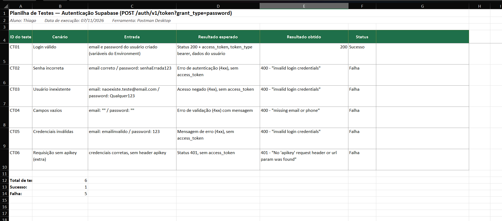

### Exemplos de registros

| ID | Cenário | Entrada | Resultado esperado | Resultado obtido | Status | Observações |
|---|---|---|---|---|---|---|
| CT01 | Login válido | `thiago.teste@email.com` + senha correta | 200 + access_token | 200 OK + access_token | Sucesso | Token JWT com expiração de 3600 s |
| CT02 | Senha incorreta | `thiago.teste@email.com` / `senhaErrada123` | Erro de autenticação | 400 — Invalid login credentials | Sucesso | Mesma mensagem do CT03 |
| CT03 | Usuário inexistente | `naoexiste.teste@email.com` / `Qualquer123` | Acesso negado | 400 — Invalid login credentials | Sucesso | Não revela se o e-mail existe |

### Importância da documentação dos testes

Documentar os testes garante **rastreabilidade** (é possível saber o que foi testado, com quais dados e qual foi o resultado), permite **reproduzir** os testes depois de uma mudança no sistema (teste de regressão), facilita a comunicação de defeitos para a equipe de desenvolvimento e serve como evidência de qualidade para quem não participou da execução.

### Falhas identificadas

Nenhuma falha funcional foi identificada: todos os 6 cenários tiveram o resultado obtido igual ao esperado. Como ponto de melhoria, a API retorna status **400 (Bad Request)** para credenciais incorretas, quando **401 (Unauthorized)** seria semanticamente mais adequado.

# Resultados Obtidos

| Total de cenários | Aprovados | Reprovados |
|---|---|---|
| 6 | 6 | 0 |

Resumo:

- **Login válido:** retornou **200 OK** com `access_token` (JWT), `token_type: bearer`, `refresh_token`, `expires_in` e os dados do usuário `thiago.teste@email.com`.
- **Cenários negativos (CT02–CT05):** todos foram bloqueados com status **400** e mensagem de erro; nenhum retornou token.
- **Sem apikey (CT06):** a requisição foi recusada com **401 Unauthorized**, mostrando que o gateway exige a chave do projeto.
- **Testes automatizados:** a collection foi executada no **Collection Runner** e todas as asserções passaram (20 de 20).

# Conclusão

**Os testes foram executados corretamente?** Sim. Os seis cenários (cinco obrigatórios e um extra) foram executados no Postman Desktop, com conferência manual das respostas e validação automática pelos scripts de teste, que passaram em todos os casos.

**A autenticação funcionou?** Sim. O login com credenciais válidas retornou status 200 e um access token JWT, e todas as tentativas com dados inválidos foram negadas sem emitir token.

**Dificuldades encontradas:**

- localizar a chave correta no painel do Supabase: a primeira chave usada era a senha do banco de dados, o que gerou o erro `401 — Invalid API key`; a chave certa é a **anon (public)**, na aba *Legacy API Keys*;
- a URL copiada do painel vinha com `/rest/v1/` no final, que é o caminho da API do banco e não o de autenticação;
- as variáveis do tipo *secret* ficavam bloqueadas no Vault do Postman e não eram enviadas, sendo necessário mudar o tipo para *default*;
- entender a diferença entre a *anon key* (pública) e a *service_role key* (acesso total, que nunca deve ser exposta).

**Falhas identificadas:** nenhuma falha funcional. Como observação, a API usa status **400** para credenciais incorretas, enquanto **401** seria semanticamente mais adequado.

**Melhorias que poderiam ser implementadas:**

- validar o formato do e-mail antes de consultar o banco, retornando um erro de validação mais específico;
- usar o status 401 para falhas de autenticação;
- configurar limite de tentativas (rate limit) e CAPTCHA para dificultar ataques de força bruta;
- exigir política de senha forte e habilitar autenticação multifator (MFA);
- ampliar os testes: expiração do token, uso do refresh token, acesso a recurso protegido com e sem token, e execução automatizada em pipeline (Newman/CI).

**Importância dos testes caixa cinza em APIs:** como APIs não possuem interface gráfica, testá-las exige conhecer pelo menos sua estrutura — endpoint, método, headers, formato do body e códigos de resposta. O teste caixa cinza aproveita esse conhecimento parcial para criar casos mais precisos que o caixa preta, sem depender do código-fonte como no caixa branca. Neste trabalho isso permitiu verificar não só se a API funciona, mas também se ela falha de forma segura: não revela se um e-mail existe na base e nunca emite tokens para credenciais inválidas.
